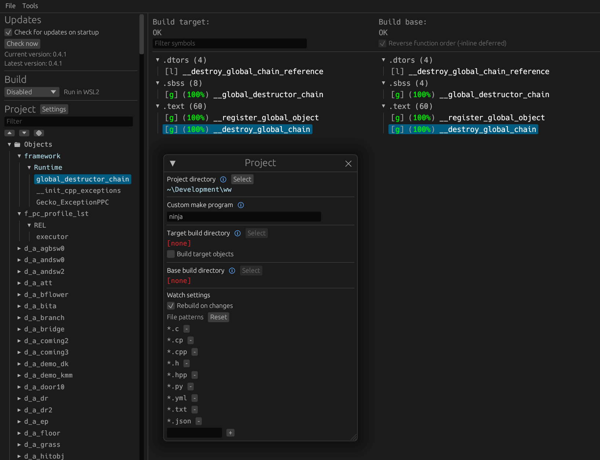

# Animal Crossing: City Folk

[![Build Status]][actions] [![Code Progress]][Progress] [![DOL Progress]][Progress] [![REL Progress]][Progress] [![Discord Badge]][discord]

[][Progress]

[Build Status]: https://github.com/ACreTeam/cf-decomp/actions/workflows/build.yml/badge.svg
[actions]: https://github.com/ACreTeam/cf-decomp/actions/workflows/build.yml
[Discord Badge]: https://img.shields.io/discord/727908905392275526?color=%237289DA&logo=discord&logoColor=%23FFFFFF
[discord]: https://discord.gg/hKx3FJJgrV
[Progress]: https://decomp.dev/ACreTeam/cf-decomp
[Code Progress]: https://decomp.dev/ACreTeam/cf-decomp/RUUE01_00.svg?mode=shield&measure=code&label=Code
[DOL Progress]: https://decomp.dev/ACreTeam/cf-decomp/RUUE01_00.svg?mode=shield&measure=code&category=dol&label=DOL
[REL Progress]: https://decomp.dev/ACreTeam/cf-decomp/RUUE01_00.svg?mode=shield&measure=code&category=modules&label=REL

A decompilation of Animal Crossing: City Folk for the Nintendo Wii.

This repository does **not** contain any game assets. An existing copy of the game is required.

Supported versions:

- `RUUE01_00`: Rev 0 (USA)
- `RUUE01_01`: Rev 1 (USA)
- `RUUP01_00`: Rev 0 (Europe/Australia)
- `RUUP01_01`: Rev 1 (Europe/Australia)
- `RUUJ01_01`: Rev 1 (Japan)
- `RUUJ01_02`: Rev 2 (Japan)
- `RUUK01_01`: Rev 1 (Korea)

`RUUE01_00` is the primary version; the other versions' configurations are
generated from it with `tools/port_version.py`.

## Dependencies

- Install [Python](https://www.python.org/downloads/).
- Install [ninja](https://github.com/ninja-build/ninja/releases).

See [Dependencies](docs/dependencies.md) for platform-specific setup. Native tooling
is recommended on Windows; WSL and MSYS2 are not required. The compiler, linker
and other build tools are downloaded automatically. On supported macOS and Linux
platforms, [wibo](https://github.com/decompals/wibo) runs the Windows compiler tools.

## Building

1. Clone the repository:

   ```sh
   git clone https://github.com/ACreTeam/cf-decomp.git
   cd cf-decomp
   ```

2. Extract your game's data partition and copy the files into `orig/<VERSION>`
   (for example `orig/RUUE01_00`). The build requires the original DOL and all
   187 RELs in this layout:

   ```text
   orig/<VERSION>/sys/main.dol
   orig/<VERSION>/files/rels/*.rel
   ```

3. Configure (the version defaults to `RUUE01_00`):

   ```sh
   python configure.py --version <VERSION>
   ```

4. Build:

   ```sh
   ninja
   ```

A successful build verifies the DOL and all RELs against their original SHA-1
hashes. See [City Folk configuration setup](docs/city_folk_config.md) for details.

## Diffing

Once the initial build succeeds, an `objdiff.json` should exist in the project root.

Download [objdiff](https://github.com/encounter/objdiff). Under project settings,
set **Project directory** to this repository. The configuration should load automatically.

Select an object from the left sidebar to begin diffing. Changes to source files,
headers, `configure.py`, `splits.txt` or `symbols.txt` trigger automatic rebuilds.



## Documentation

- [City Folk configuration setup](docs/city_folk_config.md)
- [Identified source splits](docs/identified_splits.txt)
- [`symbols.txt`](docs/symbols.md)
- [`splits.txt`](docs/splits.md)
- [GitHub Actions and decomp.dev setup](docs/github_actions.md)

## Credits

- encounter and NWPlayer123 for [dtk-template](https://github.com/encounter/dtk-template)
  and the build system.
